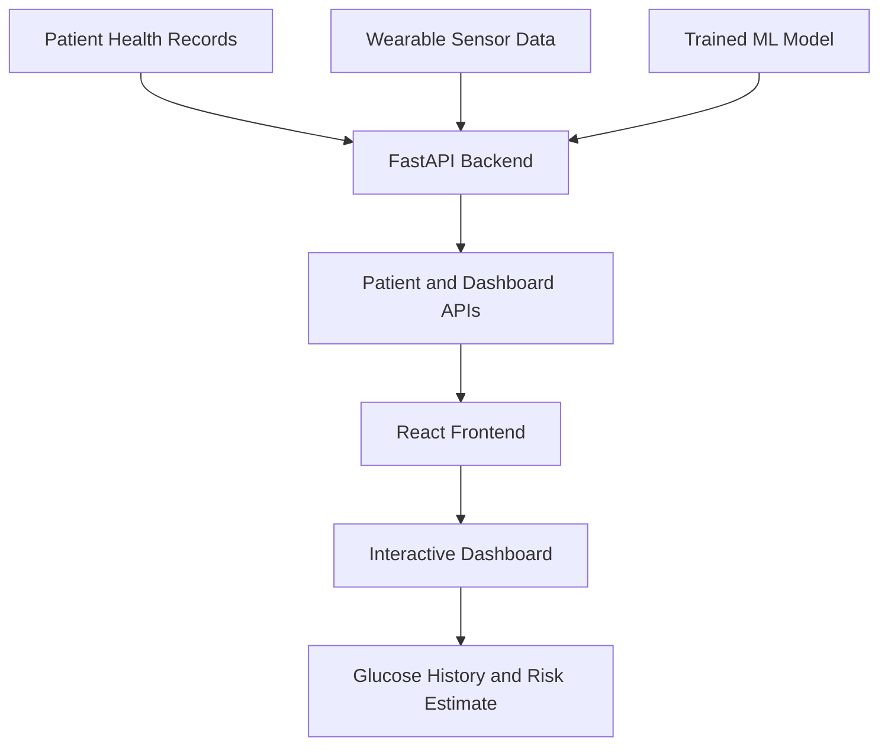

# GlucoTwin — Personalized Glucose Digital Twin

## 1. Project Overview

GlucoTwin is a prototype personalized glucose digital twin designed to explore how patient health records and wearable-device data can be combined to monitor glucose patterns and estimate glucose-related risk.

The application provides an interactive dashboard where users can select a patient and a date/time to view health information, wearable readings, glucose history, and a machine-learning prediction.

**Important:** This is a prototype built using synthetic data. Its predictions are not clinically validated and must not be used for medical diagnosis or treatment decisions.

## 2. Problem Statement

Glucose levels can change over time depending on several factors, including physical activity, sleep, heart rate, and a person's existing health profile. Viewing these measurements separately can make it difficult to understand changing patterns.

GlucoTwin combines patient information and time-based wearable data in a single dashboard to demonstrate how a digital twin could support personalized health monitoring.

## 3. Proposed Solution

GlucoTwin provides:

- **Patient selection:** Switch between multiple synthetic patient profiles.
- **Health profile:** View age, gender, BMI, HbA1c, blood pressure, and medication information.
- **Time-based monitoring:** Select a date and time to inspect available patient data.
- **Glucose history:** Explore glucose readings over time.
- **Risk prediction:** Display a machine-learning model's estimated risk score.
- **Interactive dashboard:** Present patient information and glucose-related insights in one place.

## 4. Technology Stack

| Component | Technology |
|---|---|
| Frontend | React, Vite, CSS |
| Charts | Recharts |
| Backend | Python, FastAPI |
| Data processing | Pandas, NumPy |
| Machine learning | Scikit-learn, Random Forest |
| Model storage | Joblib, Pickle |
| Data storage | CSV files |
| Development tools | VS Code, Git, GitHub |

## 5. System Architecture



The backend loads patient records, wearable readings, and the saved machine-learning model. The React frontend calls the API and displays the returned information in an interactive dashboard.

## 6. Dataset

The prototype uses synthetic data generated for demonstration purposes.

### Electronic Health Records

File: `data/ehr/ehr_data.csv`

Includes fields such as:
- Patient ID
- Age and gender
- BMI and HbA1c
- Diabetes duration
- Systolic and diastolic blood pressure
- Family history
- Medication

### Wearable Data

File: `data/wearable/wearable_data.csv`

Includes:
- Patient ID and timestamp
- Glucose level
- Heart rate
- Heart-rate variability (HRV)
- Steps
- Sleep duration
- Activity level

The generated wearable dataset contains 10 synthetic patients with readings at 30-minute intervals over seven days.

## 7. Machine-Learning Workflow

1. Prepare the wearable dataset.
2. Generate a prediction target based on future glucose readings.
3. Train a Random Forest classification model.
4. Save the trained model.
5. Load the model in the FastAPI backend.
6. Use the selected patient's available data to generate a prediction.
7. Display the model output on the dashboard.

The displayed score is a model output based on synthetic data, not a validated clinical probability.

## 8. Project Structure

```text
GlucoTwin/
├── backend/
│   ├── main.py
│   └── venv/
├── frontend/
│   ├── src/
│   │   ├── App.jsx
│   │   └── App.css
│   └── package.json
├── ml-model/
│   ├── create_prediction_target.py
│   ├── train_model.py
│   └── glucotwin_model.pkl
├── data/
│   ├── ehr/
│   │   └── ehr_data.csv
│   └── wearable/
│       ├── generate_wearable_data.py
│       ├── wearable_data.csv
│       └── wearable_with_target.csv
├── docs/
├── screenshots/
└── README.md
```

## 9. Installation and Execution

### Prerequisites

Install:
- Python 3.11 or a compatible Python version
- Node.js and npm
- Visual Studio Code

### Step 1: Start the Backend

Open a terminal in VS Code and run:

```powershell
cd backend
python -m venv venv
.\venv\Scripts\Activate.ps1
pip install fastapi uvicorn pandas numpy scikit-learn scipy joblib
python -m uvicorn main:app --reload
```

If the virtual environment already exists, activate it instead of creating it again.

Backend URL: `http://127.0.0.1:8000`

Interactive API documentation: `http://127.0.0.1:8000/docs`

### Step 2: Start the Frontend

Open a **second terminal** in VS Code and run:

```powershell
cd frontend
npm install
npm run dev
```

Frontend URL: `http://localhost:5173/`

Keep both terminal processes running while using the application.

**Note:** The backend expects the project’s CSV files and trained model to be available in their configured locations. The frontend also requires the backend to be running.

## 10. API Endpoints

| Endpoint | Purpose |
|---|---|
| `GET /api/health` | Check backend health |
| `GET /api/patients` | Retrieve patient list |
| `GET /api/patients/{patient_id}` | Retrieve a patient's profile |
| `GET /api/patients/{patient_id}/prediction?timestamp=...` | Obtain a prediction for a selected timestamp |
| `GET /api/dashboard/{patient_id}?timestamp=...` | Retrieve dashboard information |
| `GET /api/patients/{patient_id}/timestamps` | Retrieve available timestamps |
| `GET /api/patients/{patient_id}/glucose-history?timestamp=...` | Retrieve glucose history |

## 11. Future Enhancements

- Integrate real wearable devices and authorized health records.
- Validate the model using appropriate patient-level data splits and independent datasets.
- Improve prediction reliability and model explainability.
- Add authentication, patient consent, and secure data handling.
- Introduce personalized trend analysis and clinician-facing reports.
- Evaluate the prototype with healthcare professionals before any clinical use.

## 12. Conclusion

GlucoTwin demonstrates a prototype approach to personalized glucose monitoring by combining electronic health records, wearable time-series data, a machine-learning model, and an interactive web dashboard.

The project provides a foundation for exploring digital twins in healthcare while highlighting the need for data privacy, independent validation, and clinical evaluation before real-world deployment.

---

**Disclaimer:** GlucoTwin is an educational prototype that uses synthetic data. It is not a medical device and does not provide medical advice, diagnosis, or treatment recommendations.
